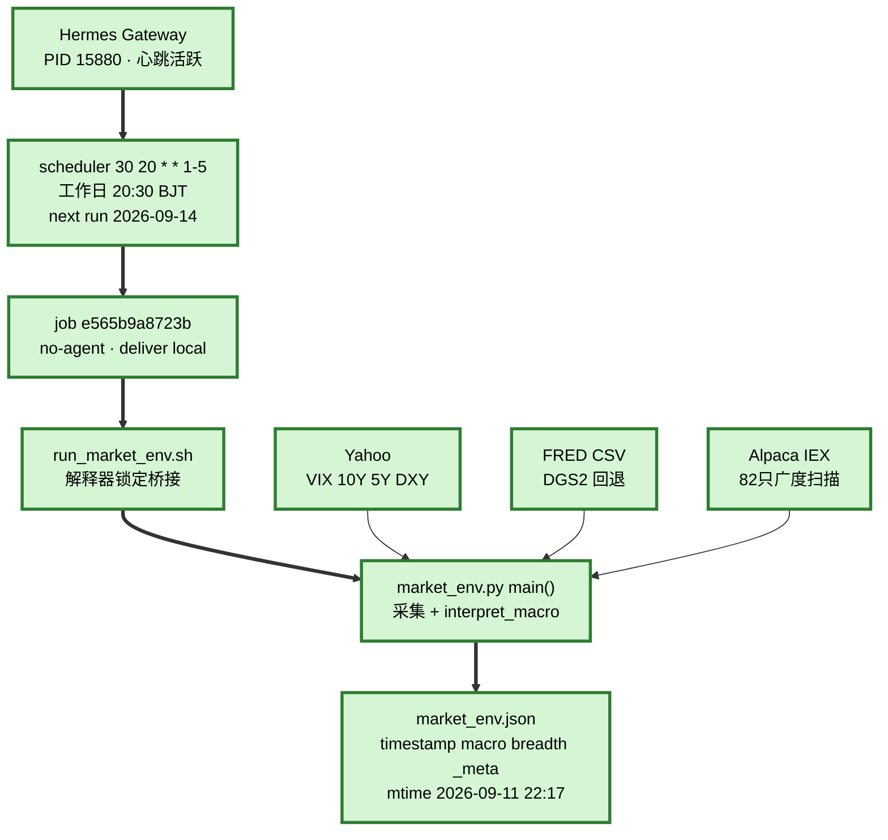
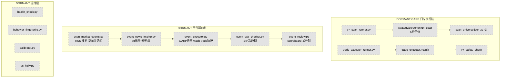
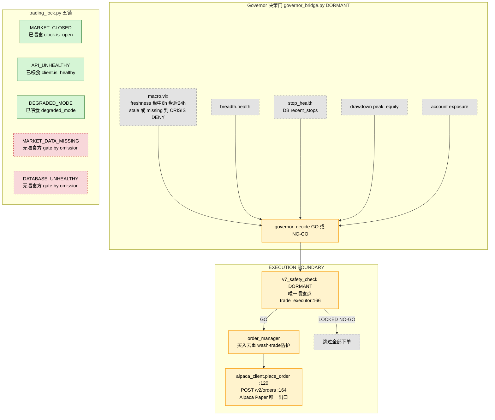
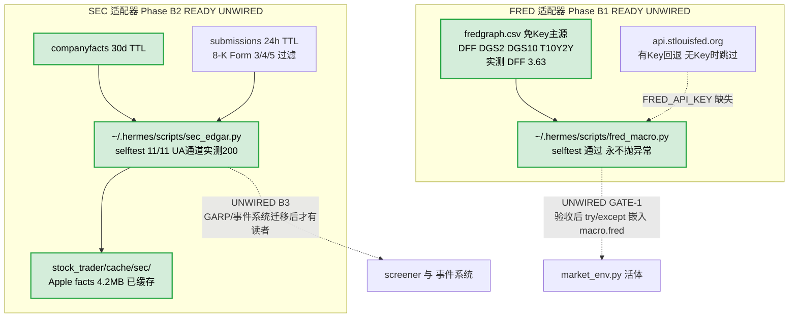
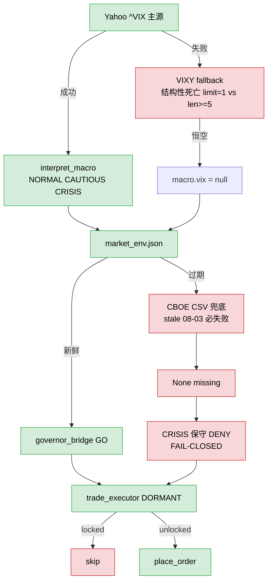

# 🦅 Eagle Eye V8 — CURRENT ARCHITECTURE DIAGRAMS（可视化实然架构）

> 生成：2026-09-13 ｜ 性质：**画出现状，非重设计**
> 证据基线：`docs/ARCHITECTURE-CURRENT.md` §0-§12（K-0~K-11 直接探针）+ repo 实代码 + 外部 runtime 实测
> 勿与 `docs/ARCHITECTURE.md`（V7.1 LTS 应然设计，Termux 时代）混用。

---

## 一、主图：三层 Source of Truth 与唯一 ACTIVE 链

```mermaid
flowchart TB
    subgraph DESIGN["DESIGN 应然设计 - docs/ARCHITECTURE.md (V7.1, Termux 时代)"]
        D1["GARP 动量扫描"]
        D2["AI 决策 MoA"]
        D3["事件驱动链"]
        D4["内部 scheduler 模块"]
    end

    subgraph IMPL["IMPLEMENTATION 代码实现 - [repo-root]/eagle_eye"]
        I1["strategy/screener.py"]
        I2["execution/trade_executor.py"]
        I3["execution/governor_bridge.py"]
        I4["risk/trading_lock.py 五锁"]
        I5["execution/order_manager.py"]
        I6["broker/alpaca_client.py<br/>place_order :120"]
        I7["strategy/market_env.py<br/>DEPRECATED DEAD"]
        I8["ai/ events/ monitoring/ scheduler/<br/>空占位 __init__.py"]
    end

    subgraph RUNTIME["RUNTIME 实际运行 - Windows + .hermes"]
        GW["Hermes Gateway<br/>PID 15880<br/>Startup 自启"]
        CRON["Hermes Cron<br/>job e565b9a8723b market_env<br/>30 20 * * 1-5 工作日 20:30<br/>no-agent deliver local"]
        SH["run_market_env.sh<br/>venv Python 3.11.15"]
        ME["~/.hermes/scripts/market_env.py<br/>collector main() 活体"]
        OUT["stock_trader/market_env.json<br/>唯一活产物"]
    end

    subgraph EXT["EXTERNAL DATA 外部数据源"]
        YF["Yahoo yfinance<br/>^VIX ^TNX ^FVX(5Y) DX-Y"]
        FCSVC["FRED fredgraph.csv<br/>DGS2 回退 免Key"]
        AIEX["Alpaca IEX<br/>82只广度"]
    end

    GW -->|"scheduler tick"| CRON
    CRON --> SH
    SH --> ME
    YF --> ME
    FCSVC --> ME
    AIEX --> ME
    ME --> OUT

    D1 -.->|"代码已实现"| I1
    D2 -.->|"代码已实现"| I2
    D3 -.->|"代码已实现"| I2
    D4 -.->|"空占位"| I8

    classDef design fill:#f0f0f0,stroke:#999,stroke-dasharray: 5 5,color:#000
    classDef impl fill:#fffff0,stroke:#c90,color:#000
    classDef active fill:#d5f5d5,stroke:#2e7d32,stroke-width:3px,color:#000
    classDef dead fill:#f8d7da,stroke:#c62828,stroke-dasharray: 4 4,color:#000
    class DESIGN
    class IMPL
    class GW,CRON,SH,ME,OUT,YF,FCSVC,AIEX active
    class I7,I8 dead
```

> 注：repo 死代码/空占位（红框）与运行时活体（绿框）分属三层——这就是 SOURCE OF TRUTH 分裂的核心事实。

---

## 二、当前唯一 ACTIVE 生产链（端到端实线）



**终点 = `market_env.json`。** 下游消费者代码存在但零调度（见主图虚线）——首个真实计划周期验收：2026-09-14 20:30（TIME-SUSTAINMENT pending）。

---

## 三、DORMANT 子系统（代码完整、接线完整、仅缺调度）



---

## 四、Governor / Trading Lock（5 锁）/ Execution Boundary



---

## 五、适配器层（READY / UNWIRED —— 未进入任何运行链）



> 审计要点：**ADAPTER READY ≠ CONSUMER CONNECTED**。两适配器当前无任何调度、无任何消费者、无 Governor 权限。

---

## 六、Fail-Safe 流向（VIX 链）



---

## Architectural Reading Rules（审计阅读规则）

| 规则 | 含义 |
|---|---|
| **实线 `-->`** | 当前真实存在的运行/调用关系 |
| **虚线 `-.->`** | 尚未接线的未来关系，或存在但无调度的 DORMANT 关系（图内已标注） |
| **🟢 绿色节点** | ACTIVE（正在运行） |
| **🟡 黄色节点** | 决策门/边界节点（Governor、trading_lock、place_order） |
| **🔴 红色节点** | 风险/缺陷（无喂食的锁、stale 兜底、死路径）或 DEAD CODE |
| **ACTIVE ≠ DESIGN** | 本图画的是 RUNTIME（实然）；`ARCHITECTURE.md` 是应然设计，两者允许不一致 |
| **ADAPTER READY ≠ CONSUMER CONNECTED** | FRED/SEC 适配器已就绪且实测，但零消费者零调度 |
| **DORMANT ≠ DEAD** | DORMANT = 代码与接线完整、仅缺调度；DEAD = 无任何运行调用方 |
| **DEAD CODE ≠ 当前运行链** | repo `strategy/market_env.py` 已标废弃，活体在外部脚本同名文件 |

---

## 事实锚点（供审计比对，全部经直接探针验证）

- 唯一 ACTIVE cron：`market_env`（job e565b9a8723b），周一至周五 20:30 BJT；无重复 job；`macro_context` 未注册。
- Gateway：PID 15880，Startup 登录自启（UAC 回退方案），心跳活跃。
- Governor 仍是决策门（fail-closed）；`place_order:120` 是唯一执行出口（paper 端点）。
- GARP = DORMANT；Event system = DORMANT；repo `strategy/market_env.py` = DEAD/DEPRECATED；旧 Termux = LEGACY（仅文档记载）。
- FRED adapter = READY / UNWIRED（GATE-1）；SEC adapter = READY / UNWIRED（B3）。
- trading locks = 5（其中 MARKET_DATA_MISSING / DATABASE_UNHEALTHY 两锁无喂食方）。
- 首个真实计划周期验收：2026-09-14 20:30（K-10 九条 PASS 标准就绪）。
